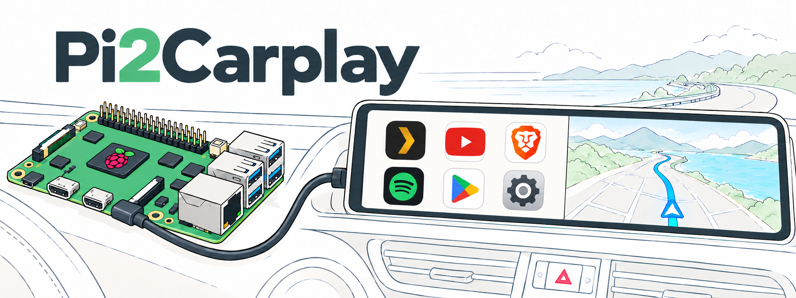

# Pi2Carplay

Run Android apps on your car's wired CarPlay display using hardware you control. Pi2Carplay brings the CarPlay bridge to a Raspberry Pi 5, replacing an off-the-shelf "AI box" with a ready-to-flash Android image and source you can adapt.

Includes a dashboard launcher, editable favorites, split screen, audio and touch. The bridge reads the display's negotiated resolution and usable area.

**Early testing release. More vehicles and display sizes need testing. Wired CarPlay only.**

## What you need

- Raspberry Pi 5 with **2GB RAM or more**. 4GB is recommended.
- Fast **U3 microSD, 16GB or larger**, and a card reader.
- Display with a micro-HDMI cable and a USB mouse for first boot. A keyboard is optional. Technically you can setup without this and bring Pi right to car but makes things easier to log in and configure android first.
- Reliable power. Some vehicle USB ports cannot supply enough power. Pi 5 needs 5v 3a Minimum. Pi2Carplay uses a single connected to a wired carplay port for Data and power from the Pi's usb-c connector
- A **wired CarPlay** USB data port and a data-capable cable to the Pi's **USB-C port**.
- Wi-Fi or a phone hotspot for app downloads, sign-in and streaming.

## Get started

1. Download the `.img.gz` image from [Releases](https://github.com/Fotsbeats/Pi2Carplay/releases).
2. Open [Raspberry Pi Imager](https://www.raspberrypi.com/software/), select **Raspberry Pi 5**, then **Use custom** under the operating system choices. Select the downloaded image.
3. Select your microSD and write it. **This erases the card.** Skip Raspberry Pi OS customization and let verification finish.
4. Put the card in the Pi. Connect the display, mouse and power. Allow several minutes for first-boot app installation, then connect Wi-Fi and sign into your apps.
5. Shut down the Pi. Move it to the vehicle and connect its **USB-C port to the CarPlay data port**. Power it on and allow about a minute for Android to appear. The Pi's USB-A ports are for accessories.

No personal accounts or saved networks are included. Play Store availability and certification can vary. ADB is enabled for setup and requires authorization. Larger cards do not expand automatically yet.

## Build and adapt
Includes an Agents.md so you can customize this to your needs, change launcher themes and configure Android to your liking.

Based on [KonstaKANG AOSP 16](https://konstakang.com/devices/rpi5/AOSP16/) and [Raspberry Vanilla](https://github.com/raspberry-vanilla). The source can be adapted to other Pi Android builds and Android versions; these are not drop-in image upgrades. See [AGENTS.md](AGENTS.md) for the bridge contracts to preserve.

Project source and bundled components have separate licenses. The Android base includes non-commercial components, and the protocol SDK remains a binary dependency. See [LICENSE-SCOPE.md](LICENSE-SCOPE.md).
